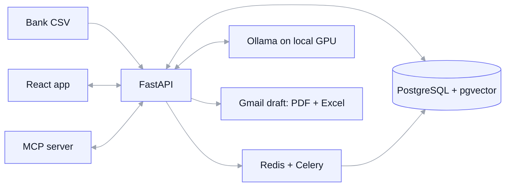

# Skarbonka

**Local-first AI for settling household expenses.** Import a bank CSV, let rules, ML and a local LLM sort the spending, untick what's personal, and send a clean settlement report. All of it runs on your own machine.


## Why

I buy groceries for the household and get reimbursed by my parents. Until now that meant a Jupyter notebook, hand-cleaned bank exports, regex categories, and dropping personal purchases by row index. Skarbonka (Polish for *piggy bank*) turns it into a few clicks, without sending a single transaction to a cloud AI.

## Features

- [ ] **Smart CSV import (ING):** detects encoding and header, skips bank boilerplate, deduplicates, and checks totals against the bank's own summary
- [ ] **Layered categorization:** your rules → merchant memory → ML classifier → local LLM, each with a confidence score and a review queue
- [ ] **Personal vs shared:** one click to exclude a purchase, or split a receipt into parts
- [ ] **Settlements:** any period, PDF + Excel report, Gmail draft, automatic matching of the refund transfer
- [ ] **Dashboard:** category breakdown, trends, and next-month forecasts with uncertainty bands
- [ ] **AI assistant:** ask about your spending in Polish or English, backed by tools over MCP and read-only text-to-SQL

## Privacy by design

- Every model (LLM, embeddings, speech) runs locally via [Ollama](https://ollama.com). No cloud AI keys anywhere.
- Real bank exports never leave the machine and never enter the repo. Tests and the demo use synthetic data only.
- The only outbound traffic is the finished report you choose to email.

## Architecture



**Stack:** Python 3.12 · FastAPI · SQLAlchemy 2 · PostgreSQL + pgvector · React + TypeScript · shadcn/ui · ECharts · Ollama · scikit-learn · MLflow · Docker Compose

## Getting started

> Work in progress: setup instructions land with the first runnable version.

Requirements: Docker Desktop, [uv](https://docs.astral.sh/uv/), Node.js LTS, Ollama, and a GPU with 8 GB VRAM recommended for the LLM features.

```bash
git clone https://github.com/<you>/skarbonka.git
cd skarbonka
docker compose up -d
```

## Roadmap

| Stage | Scope | Status |
| --- | --- | --- |
| MVP | ING import, rules + ML categorization, review, settlements, PDF/Excel, Gmail draft, basic dashboard | In progress |
| 2 | Local LLM categorization, background jobs, retraining from corrections, MLflow, mBank import | Planned |
| 3 | Trends, anomalies, per-category forecasts with conformal intervals | Planned |
| 4 | AI assistant: MCP tools, text-to-SQL, approved actions, voice | Planned |
| 5 | Demo mode on synthetic data, parent accounts, remote access via Tailscale | Planned |

Design docs live in [`docs/`](docs/).

## License

[MIT](LICENSE)
